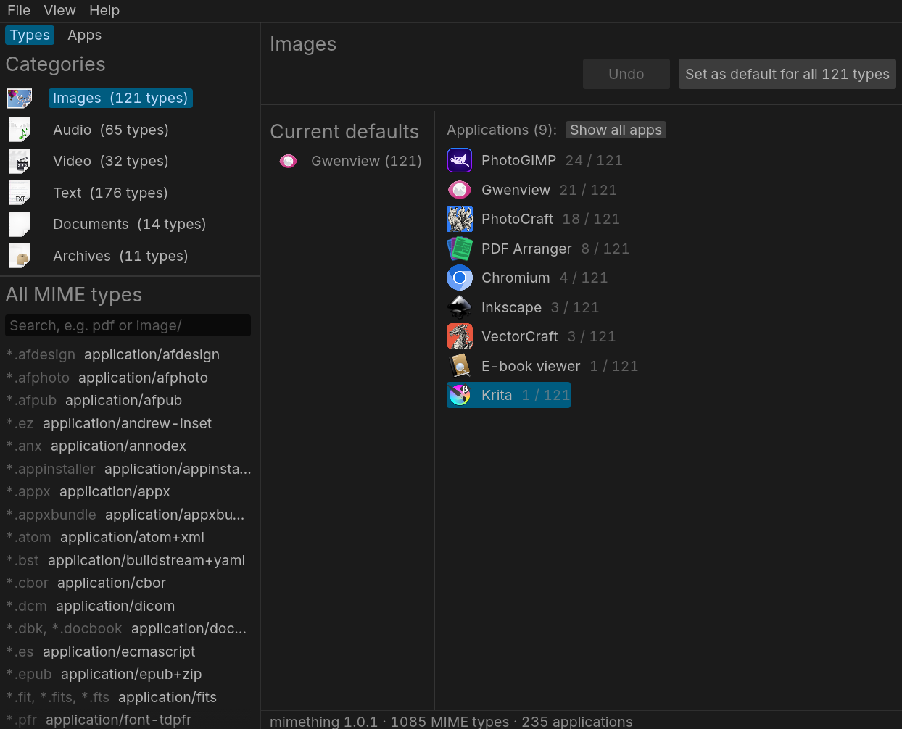

# mimething

A Linux GUI to change which application opens each file type

## Features
- Set the default application to open a category of mime types
- Set the default application to open a specific mime type
- View the mime types that an application is able to open

## Download
[Linux](https://github.com/plucafs/mimething/releases)

## Credits

- [fastframe](https://github.com/crmne/fastframe)
- [OpenCode](https://github.com/anomalyco/opencode)

## License

MIT
